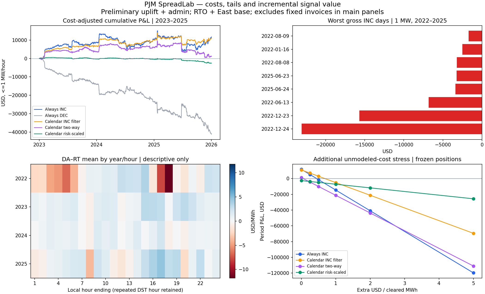
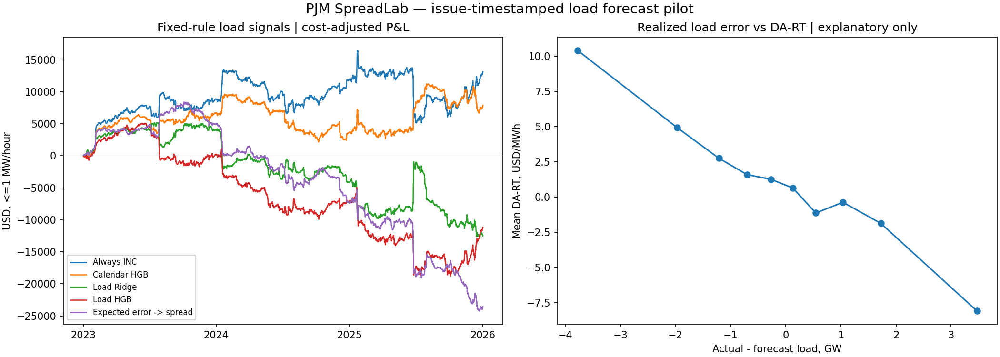
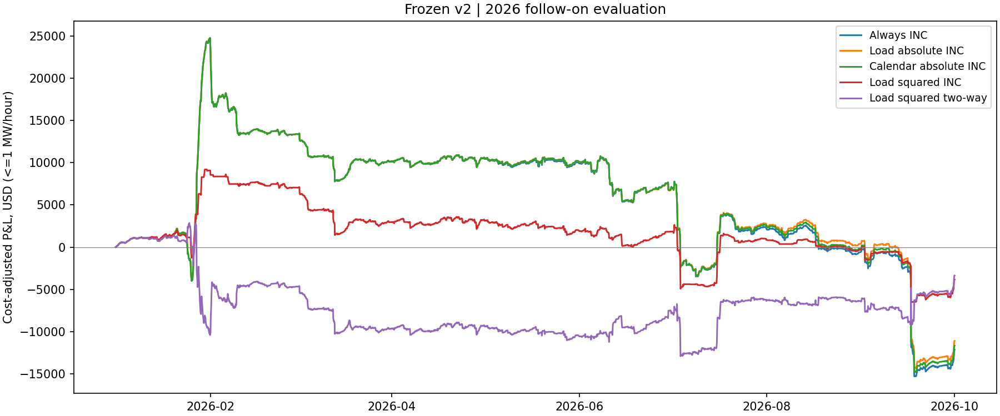

# PJM SpreadLab

Can a positive day-ahead versus real-time price spread actually survive the costs of virtual bidding?

I started with a simple result: an unconditional 1 MW INC position at PJM Western Hub had a mean gross DA–RT spread of $0.95/MWh over 2023–2025. The modeled costs were about $0.50/MWh. That looked like a small premium, but it left two questions: how much depended on a few bad hours, and would a forecast help after the costs of putting on the trade?

I reconstructed administrative and operating-reserve charges, examined the loss tail, and then tested calendar and timestamped load-forecast signals. I also kept a separate 2026 follow-on evaluation whose policy and code were frozen before this project downloaded numeric 2026 spread outcomes. This is a study of trading economics and failed signals, not a claim of live trading alpha.

## Results at a glance

| Measure | Historical baseline (2023–2025) | Follow-on (Jan–Sep 2026) | Interpretation |
|---|---:|---:|---|
| Mean gross DA–RT spread for unconditional INC | $0.950/MWh | $0.450/MWh | Different observation periods and samples |
| Mean modeled cost for unconditional INC | $0.503/MWh | $2.306/MWh | Reconstruction, not a final participant invoice |
| Always INC, modeled cost-adjusted P&L | — | -$12,119 | Same 2026 forecast-covered comparison sample |
| Primary load absolute-loss INC/no-trade, modeled P&L | — | -$11,085 | Better than Always INC, but still negative |
| Squared-loss load INC control, modeled P&L | — | -$3,823 | A control outperformed the primary variant |

**Sample coverage:** The spread and modeled-cost baseline uses **2023–2025**, while the historical tail-risk analysis covers **2022–2025**, including Winter Storm Elliott in December 2022.

The historical and 2026 spread/cost averages are **descriptive comparisons**, not a matched-sample causal estimate. P&L is modeled on the stated 1 MW strategy convention; it is not executable net trading profit. The 2026 strategy comparison uses **6,528 forecast-covered hours**.

## Findings

1. **Costs were large enough to change the trade.** Historical gross DA–RT spreads were positive on average, but cost reconstruction substantially reduced their appeal. In the 2026 follow-on period, the modeled average cost exceeded the unconditional gross spread. Operating-reserve charges, rather than Schedule 9 alone, drove much of the increase.
2. **The average concealed an unpleasant tail.** Winter Storm Elliott in December 2022 had an outsized effect on the historical signal estimates and on DEC exposure in certain hours. Excluding those days from *training* was useful as a post-hoc influence check, not an implementable rule for predicting a future storm.
3. **A forecast can be useful without being a profitable trading signal.** Calendar groups and timestamped day-ahead load forecasts showed structure, but their tested trading policies did not establish a robust cost-adjusted edge. Forecast accuracy and P&L answer different questions.
4. **The 2026 follow-on did not rescue the primary model.** The absolute-loss INC/no-trade strategy lost $11,085 against -$12,119 for Always INC. An equal-volume INC control beat the primary by $89, with a paired interval spanning zero; the squared-loss control did better still. I kept these controls rather than selecting a better-looking result after the fact.
5. **The evaluation rules matter.** The 2026 policy and implementation were hashed before numeric outcome downloads *in this project*, with monthly expanding fits and a 90-day label embargo. This is not a completely untouched blind test: some 2026 prices had been seen in other work, and historical publication-time vintages are not fully reconstructed.

## Charts

### Costs and spread tail



### Calendar and load signals



### Frozen 2026 follow-on



The figures are research diagnostics; numerical assumptions and full comparisons are in the reports below.

## What this tells a trader

- A spread that looks attractive before charges can disappear when participation and deviation costs are reconstructed. It matters which charges apply to which virtual position, not just their overall magnitude.
- Rare price outcomes can dominate the distribution. A better average backtest is not necessarily a better position if losses concentrate in stress hours.
- A model should be judged against simple, volume-aware controls and against **not trading**. A relative improvement over a losing benchmark does not establish an edge.

## Reports and audit trail

| File | What it contains |
|---|---|
| [Cost, risk and calendar signals](outputs/PJM_Cost_Risk_Signals.html) | Historical cost reconstruction, tails and initial signals (Chinese HTML) |
| [Timestamped load-signal study](outputs/PJM_Load_Signals.html) | Forecast selection, signal tests and diagnostics (Chinese HTML) |
| [Frozen 2026 evaluation](outputs/PJM_2026_Frozen_Evaluation.html) | Follow-on results and controls (Chinese HTML) |
| [METHODS.md](METHODS.md) | Accounting conventions, chronological rules and limitations |
| [CLOSEOUT.md](CLOSEOUT.md) | Final conclusions and carefully scoped result wording |
| [BASELINE.md](BASELINE.md) | Earlier milestone, preserved rather than rewritten as the final result |
| [2026 configuration](signal_v2_config.json) / [policy freeze](signal_v2_freeze.json) / [code freeze](signal_v2_code_freeze.json) | Original records supporting the frozen evaluation |

**Language note:** The three detailed HTML reports are in Chinese. This README provides the English-language summary of the research questions, methods, principal results and limitations. An English version of the frozen 2026 evaluation is not yet included.

GitHub displays HTML reports as source/downloadable files rather than always rendering them in the repository view. Download an HTML file and open it locally in a browser to read the formatted report.

## Scope and limits

- **Research P&L, not realized trading P&L.** Costs use public Schedule 9 rates, preliminary operating-reserve charges and explicit regional/invoice assumptions; participant-specific final settlement charges, exemptions, rejected bids and other operational effects are not fully modeled.
- **Historical research is retrospective.** The 2022–2025 sample had been inspected. Chronological separation and a 60- or 90-day training embargo do not by themselves establish point-in-time settlement-label availability.
- **Forecast timestamps are not perfect publication logs.** The load pilot uses forecasts available under a stated D−1 10:00 EPT cutoff and a 15-minute buffer; `evaluated_at` is treated as creation time, with the documented limitations.
- **The 2026 result is a fixed-rule follow-on, not a fully pristine holdout.** Policies and hashes were recorded before this project's outcome download, but other prior work had used some 2026 DA prices. The one-shot evaluator is deliberately not presented as something to rerun for a fresh independent test.
- **No profitable deployed strategy is claimed.** All reported variants, including unsuccessful ones, are retained; confidence intervals are exploratory and do not fix post-selection bias.

## Replication

Install the dependencies:

```bash
python -m pip install -r requirements.txt
```

The historical pipeline is split into downloads, analysis and checks:

```bash
python fetch_baseline.py
python fetch_costs.py
python analyze.py
python research.py
python validate_research.py
python fetch_forecasts.py
python fetch_actual_load.py
python signals.py
python validate_signals.py
```

These commands are **not** a one-command reproduction from a clean checkout: the raw PJM datasets and caches are not redistributed. Fetch scripts need a `PJM_API_KEY` or prompt for one. For the frozen 2026 result, inspect the retained configuration, hash records, HTML report and methodology; `validate_v2.py` can audit original numerical artifacts **when those local outputs are available**, but the one-shot `signal_v2.py` should not be rerun and called a new holdout result.

## Repository layout

- `fetch_*.py`, `check_2026_availability.py` — PJM download/availability scripts
- `analyze.py`, `research.py`, `signals.py`, `signal_v2.py` — historical research and signal evaluation
- `validate_*.py` — output validation scripts requiring corresponding local results
- `*_config.json`, `signal_v2_*freeze.json` — parameter and freeze records
- `outputs/` — selected public HTML reports, Markdown summaries and figures; no raw data or hourly ledgers
- `METHODS.md`, `BASELINE.md`, `CLOSEOUT.md` — methodology, milestones and final interpretation

## Data

Prices, cost rates and forecasts were retrieved through PJM Data Miner 2 and related public PJM records. Raw responses are deliberately excluded from this release. See [METHODS.md](METHODS.md) for the mapping and accounting qualifications.
